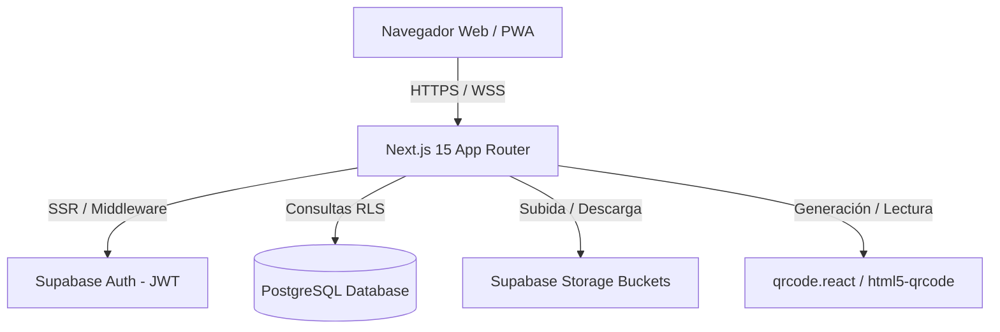

# Arquitectura del Sistema EcuRutas

Documento de arquitectura técnica de software para la aplicación web de gestión y venta de pasajes interprovinciales.

---

## 1. Visión General y Patrón Arquitectónico

La aplicación implementa una arquitectura **BaaS (Backend as a Service) sin servidor de backend intermedio**, utilizando **Next.js 15 (App Router)** como capa de presentación y orquestación frontend, y **Supabase** como plataforma integral de infraestructura (Base de Datos PostgreSQL, Autenticación, Row Level Security y Storage de archivos).

---

## 2. Decisiones de Diseño y Principios

1. **Sin Backend Propio (BaaS Puro)**:
   - Toda la lógica de persistencia y validación de seguridad de datos reside en las políticas **Row Level Security (RLS)** de PostgreSQL.
   - El cliente web se comunica directamente con las APIs RESTful de Supabase mediante `@supabase/ssr` y `@supabase/supabase-js`.
   - **Regla estricta:** La clave `service_role` está terminantemente prohibida en el frontend para evitar brechas de seguridad.

2. **Modularización para Trabajo Concurrente (`src/modules/*`)**:
   - Para permitir que 6 desarrolladores avancen en paralelo durante una semana sin colisiones de Git, cada módulo de negocio tiene su propio directorio en `src/modules/<modulo>/`.
   - Cada carpeta de módulo encapsula sus componentes, hooks, interfaces y adaptadores, exponiendo únicamente lo necesario a las rutas de `src/app/`.

3. **Autenticación y Autorización en el Borde (Edge Middleware)**:
   - `src/middleware.ts` intercepta cada petición antes de renderizar la página.
   - Lee el JWT de sesión en las cookies, sincroniza el token y consulta la tabla `"Usuario"` para validar el campo `"rol"` y `"activo"`.
   - Los roles autorizados son redirigidos exclusivamente a sus portales correspondientes (`/admin`, `/cooperativa`, `/oficina`, `/chofer`, `/pasajero`).

---

## 3. Matriz de Roles y Accesos

| Rol en BD | Descripción | Prefijo de Ruta | Permisos Clave |
|-----------|-------------|-----------------|----------------|
| `admin` | Administrador general de la plataforma | `/admin/*` | Supervisión de cooperativas, usuarios y auditoría global. |
| `cooperativa` | Encargado o gerente de cooperativa | `/cooperativa/*` | Gestión de buses, asignación de frecuencias y choferes. |
| `oficinista` | Personal de boletería / ventanilla | `/oficina/*` | Emisión presencial de pasajes y validación de comprobantes. |
| `chofer` | Conductor o ayudante de unidad | `/chofer/*` | Escaneo QR de boletos en abordaje y reporte de paradas. |
| `usuario` | Pasajero cliente registrado | `/pasajero/*` | Búsqueda de pasajes, compra online y visualización de QR. |
| *Público* | Visitante no autenticado | `/`, `/busqueda` | Consulta del catálogo público de frecuencias y cooperativas. |

---

## 4. Almacenamiento de Archivos (Supabase Storage)

| Bucket | Visibilidad | Uso | Restricción RLS |
|--------|-------------|-----|-----------------|
| `comprobantes` | **Privado** | Comprobantes de transferencia subidos por pasajeros. | Lectura: propio usuario, oficinista y admin. Escritura: pasajero. |
| `buses` | **Público** | Fotografías de las unidades y diagramas de asientos. | Lectura: pública. Escritura: cooperativa y admin. |
| `logos` | **Público** | Logos institucionales de las cooperativas y app. | Lectura: pública. Escritura: admin y cooperativa. |
