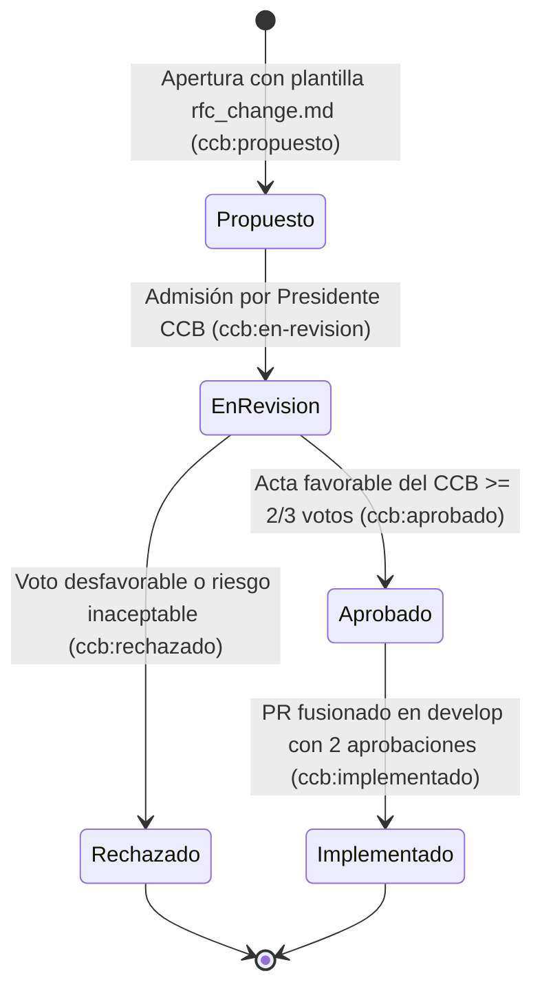

# Política del Comité de Control de Cambios (CCB) – PROYECTO_MANEJO_SP2

Documento normativo oficial del **Comité de Control de Cambios (Change Control Board – CCB)** para el proyecto **EcuRutas – Sistema Interprovincial de Venta de Pasajes** (Materia: *Manejo y Configuración de Software*, Carrera de Software, Universidad Técnica de Ambato).

---

## 1. Propósito

Establecer la estructura organizativa, atribuciones, reglas de votación, tiempos de respuesta y ciclo de vida formal para evaluar todas las **Solicitudes de Cambio (RFC – Request for Change)** que impacten la línea base del proyecto en las ramas `develop` y `main`, el esquema PostgreSQL/RLS en Supabase o los módulos críticos del sistema.

---

## 2. Integración del Comité de Control de Cambios (CCB)

El CCB está constituido por tres miembros titulares con derecho a voz y voto para cada solicitud de cambio:

| Cargo en el CCB | Integrante | Usuario GitHub | Rol Técnico en el Proyecto |
|-----------------|------------|----------------|----------------------------|
| **Presidente del CCB / Gestor de Configuración** | Juan José Carvajal Jaya | [@juanjose1234456787654](https://github.com/juanjose1234456787654) | Líder de Proyecto, Infraestructura, Supabase y CI/CD |
| **Vocal Técnico 1 (Lógica de Negocio / Datos)** | Andrés Toasa | [@The-Fabry](https://github.com/The-Fabry) | Reglas de negocio ANT, tramos, descuentos y hojas de ruta |
| **Vocal Técnico 2 (Rotativo por Fase Impactada)** | Celeste Telenchana / Anahí Morales / Mateo Morales / Jeremy Guaman | [@CelesteTelenchanaa](https://github.com/CelesteTelenchanaa) / [@AnahiM2025](https://github.com/AnahiM2025) / [@SebastianM-M](https://github.com/SebastianM-M) / [@levi06516-ui](https://github.com/levi06516-ui) | Responsable del módulo o fase directamente relacionada con la RFC |

> **Regla de independencia:** Cuando el autor de una RFC es uno de los vocales técnicos, el tercer voto lo ejerce otro integrante titular para garantizar al menos **2 revisiones cruzadas** además del autor.

---

## 3. Cómo Proponer una Solicitud de Cambio (RFC)

1. Ingresar a la pestaña **Issues → New issue** del repositorio y seleccionar la plantilla oficial **[RFC – Propuesta de Cambio (CCB)](../.github/ISSUE_TEMPLATE/rfc_change.md)**.
2. Completar obligatoriamente las secciones de la plantilla:
   - **Propuesta:** descripción técnica concreta del cambio.
   - **Motivación:** problema actual o requerimiento normativo (ANT / seguridad / arquitectura) que justifica el cambio.
   - **Impacto:** archivos (`src/...`), tablas en Supabase (`"Tabla"`) y nivel de impacto (*Alto / Medio / Bajo*).
   - **Alternativas consideradas:** al menos 2 opciones técnicas evaluadas y el motivo de descarte.
   - **Riesgo y plan de mitigación:** posibles regresiones y estrategia de reversión (*rollback*).
3. Al crearse el issue, recibe automáticamente las etiquetas `tipo:rfc` y `ccb:propuesto`, y se incorpora al **[Tablero de Gestión de Configuración](https://github.com/users/juanjose1234456787654/projects/1)** en la columna `Propuesto`.

---

## 4. Reglas de Votación y Tiempos de Respuesta (SLA)

| Etapa | Responsable | Tiempo Máximo (SLA) | Quórum Requerido |
|-------|-------------|---------------------|------------------|
| **1. Admisión y paso a revisión** | Presidente del CCB (`@juanjose1234456787654`) | **12 horas** desde la apertura de la RFC | Verificación de que la plantilla `rfc_change.md` esté completa |
| **2. Evaluación técnica y votación** | Presidente + 2 Vocales del CCB | **24 a 48 horas** máximo | Mayoría calificada: **mínimo 2 votos favorables de 3** y 0 bloqueos críticos de seguridad |
| **3. Verificación de implementación en PR** | 2 Revisores con permisos de escritura | **24 horas** desde la apertura del PR hacia `develop` | **2 aprobaciones formales en el Pull Request** + compilación `npm run build` exitosa |

---

## 5. Ciclo de Vida de una RFC y Etiquetas Oficiales

Toda RFC transita de forma trazable por los siguientes estados tanto en las etiquetas del Issue (`ccb:*`) como en el campo `Status` del tablero de GitHub Projects v2:

| Estado en Tablero | Etiqueta en GitHub | Significado Operativo |
|-------------------|--------------------|-----------------------|
| **Propuesto** | `ccb:propuesto` | RFC registrada por el autor, pendiente de admisión formal. |
| **En revisión por CCB** | `ccb:en-revision` | El CCB analiza impacto en arquitectura, tablas Supabase, RLS y cronograma. |
| **Aprobado** | `ccb:aprobado` | Cambio autorizado mediante comentario de acta del CCB; habilita fusionar el PR de la tarea asociada. |
| **Implementado** | `ccb:implementado` | El cambio fue codificado, verificado y su Pull Request fue fusionado en `develop`. |
| **Rechazado** | `ccb:rechazado` | Solicitud denegada con justificación técnica registrada en el issue; no se modifica la línea base. |

---

## 6. Registro Oficial de RFCs del Segundo Parcial

| Código | Issue | Título de la Solicitud de Cambio | Autor | Tarea Vinculada | Fase |
|--------|-------|----------------------------------|-------|-----------------|------|
| **RFC-001** | [#26](https://github.com/juanjose1234456787654/PROYECTO_MANEJO_SP2/issues/26) | Migrar de `mockData` a Supabase real | `@juanjose1234456787654` (Juan) | [#11 (J2)](https://github.com/juanjose1234456787654/PROYECTO_MANEJO_SP2/issues/11) | Fase 1 – Infraestructura |
| **RFC-002** | [#27](https://github.com/juanjose1234456787654/PROYECTO_MANEJO_SP2/issues/27) | Tarifa proporcional por tramos en paradas intermedias | `@The-Fabry` (Andrés) | [#14 (A1)](https://github.com/juanjose1234456787654/PROYECTO_MANEJO_SP2/issues/14) | Fase 2 – Negocio |
| **RFC-003** | [#28](https://github.com/juanjose1234456787654/PROYECTO_MANEJO_SP2/issues/28) | Firma HMAC-SHA256 del QR del boleto | `@SebastianM-M` (Mateo) | [#33 (M1)](https://github.com/juanjose1234456787654/PROYECTO_MANEJO_SP2/issues/33) | Fase 5 – QR |
| **RFC-004** | [#29](https://github.com/juanjose1234456787654/PROYECTO_MANEJO_SP2/issues/29) | Contenedor único de comprobantes y máquina de estados del pago | `@AnahiM2025` (Anahí) | [#30 (N1)](https://github.com/juanjose1234456787654/PROYECTO_MANEJO_SP2/issues/30) | Fase 4 – Pagos |
