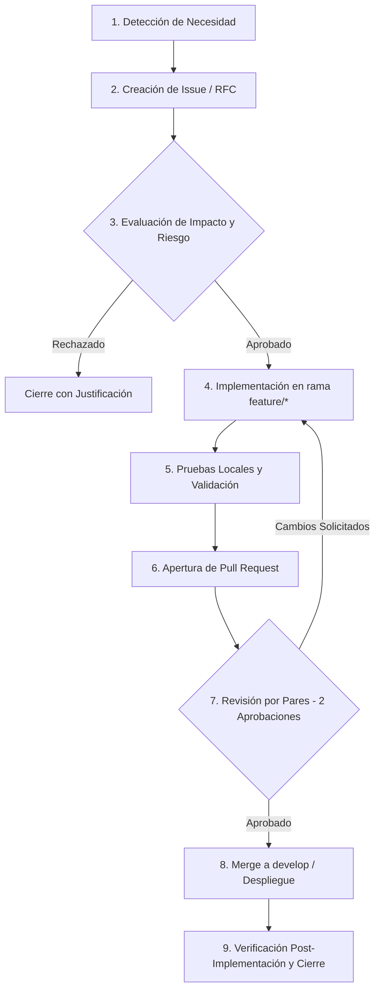

# Procedimiento de Gestión y Control de Cambios (ITIL)

Procedimiento formal para la solicitud, evaluación, aprobación, implementación y trazabilidad de cambios en el proyecto **EcuRutas** (Manejo y Configuración de Software - UTA).

---

## 1. Propósito y Alcance

Garantizar que todos los cambios aplicados al código fuente, esquema de base de datos en Supabase, dependencias o infraestructura sean registrados, evaluados por impacto y aprobados formalmente antes de su integración a las ramas principales (`develop` y `main`), minimizando interrupciones operativas y asegurando trazabilidad académica.

---

## 2. Clasificación de Cambios (Tipologías ITIL)

| Tipo de Cambio | Criterio de Aplicación | Nivel de Aprobación | Tiempo de Respuesta |
|----------------|------------------------|---------------------|---------------------|
| **Estándar** | Tareas rutinarias preaprobadas (correcciones tipográficas, actualización de documentación menor, adición de logs locales). | 1 Aprobador del equipo | < 12 horas |
| **Normal** | Nuevas funcionalidades, modificación de interfaces de usuario, ajustes de CSS, creación de nuevos componentes en módulos. | **2 Aprobadores (CAB)** vía Pull Request | < 24 horas |
| **Mayor / Crítico** | Alteraciones al esquema SQL de Supabase, modificación de políticas RLS, cambios en el `src/middleware.ts` o actualización de dependencias principales. | **Líder de Configuración + 2 Desarrolladores** | Evaluación formal en reunión técnica |
| **Emergencia** | Fallos críticos en producción que impiden el login o bloquean el flujo de compra. | Líder del Proyecto (hotfix directo a `main` y reincorporación a `develop`). | Inmediata |

---

## 3. Flujo del Proceso de Cambio

---

## 4. Elementos de Configuración (CI - Configuration Items)

Los siguientes artefactos son considerados Elementos de Configuración auditables bajo control estricto:

1. **Esquema de Base de Datos**: Migraciones SQL en `supabase/schema_supabase.sql`.
2. **Definiciones de Tipos**: `src/types/database.types.ts`.
3. **Mecanismo de Seguridad**: `src/middleware.ts` y políticas RLS en PostgreSQL.
4. **Dependencias del Proyecto**: `package.json` y `package-lock.json`.
5. **Configuración de Variables de Entorno**: `.env.example`.
6. **Políticas de Integración**: `.github/` (Workflows, Templates y CODEOWNERS).

---

## 5. Plan de Rollback (Reversión)

Si un cambio aprobado genera inestabilidad tras su integración en `develop`:
1. El Configuration Manager ejecutará un `git revert <commit-hash>` para generar un commit inverso limpio sin alterar la historia.
2. Si el problema involucra un script SQL en Supabase, se ejecutará el script de migración inversa (`DOWN`) preparado previamente en la Petición de Cambio.
3. Se documentará el incidente en un Issue de tipo `bug-report` para su posterior análisis de causa raíz.
