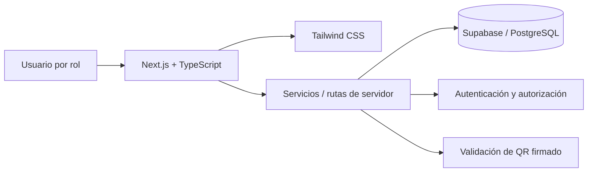

# Defensa del segundo parcial — Sistema de Gestión y Venta de Pasajes Interprovinciales

> **Proyecto:** PROYECTO_MANEJO_SP2 · **Universidad:** Universidad Técnica de Ambato · **Carrera:** Ingeniería en Software  
> **Duración total:** 28 minutos · **Equipo:** Juan, Andrés, Celeste, Anahí, Mateo y Jeremy  
> **Issue:** [#38](https://github.com/juanjose1234456787654/PROYECTO_MANEJO_SP2/issues/38) · **Rama:** `feature/docs-defensa-diapositivas`  
> **Corte documental:** 9 de noviembre de 2026. Validar los datos y la disponibilidad del entorno de demostración el día de la defensa.

<!-- Cada bloque separado por --- representa una diapositiva; compatible con la mayoría de exportadores Markdown a slides. -->

---

## Diapositiva 1. Portada y agenda (Jeremy — 1 min)

**Sistema de Gestión y Venta de Pasajes Interprovinciales**

- Universidad Técnica de Ambato — Ingeniería en Software
- Equipo: Juan Carvajal, Andrés Toasa, Celeste Telenchana, Anahí Morales, Mateo Morales y Jeremy Guaman
- Agenda: problema y arquitectura; Gitflow/CCB; demostración de extremo a extremo; evidencias; conclusiones

**Mensaje clave:** Un flujo conectado desde la búsqueda de viajes hasta el embarque.

---

## Diapositiva 2. Contexto y necesidad (Juan — dentro de 3 min)

- Digitalizar la compra y control de pasajes interprovinciales.
- Reducir pasos manuales y mejorar trazabilidad de transacciones, boletos y embarques.
- Perfiles involucrados: pasajero, personal de oficina, chofer y administración.
- Necesidad de registrar rutas, frecuencias, paradas, asientos, pagos y validación de boletos.

**Visual sugerido:** mapa del flujo del pasajero: buscar → seleccionar → pagar → recibir QR → embarcar.

---

## Diapositiva 3. Reglas de negocio y marco ANT (Juan — completar bloque de 3 min)

- Paradas intermedias y determinación de tramos de viaje.
- Aplicación de descuentos definidos por la lógica de negocio para grupos elegibles.
- Controles y validaciones de operación vinculados al transporte interprovincial.
- **Advertencia:** mostrar en el informe las fuentes normativas precisas y comprobar los porcentajes y condiciones vigentes; esta presentación no afirma tarifas o porcentajes no verificados.

**Visual sugerido:** ejemplo de cotización con campos origen, destino, tramo y categoría del pasajero.

---

## Diapositiva 4. Arquitectura y stack tecnológico (Juan — 3 min)

- **Next.js:** interfaz y funcionalidades de la aplicación web.
- **TypeScript:** tipado de componentes y lógica.
- **Tailwind CSS:** diseño y experiencia visual.
- **Supabase / PostgreSQL:** persistencia y gestión de datos.
- **HMAC-SHA256:** integridad de los tokens QR de boletos.

**Durante la exposición:** recorrer una solicitud completa, de pantalla a base de datos.

---

## Diapositiva 5. Gestión de configuración (Juan — 3 min)

- Gitflow: `main` (estable), `develop` (integración), `feature/*` (trabajo aislado).
- Pull Requests hacia `develop` y revisión previa a la integración.
- Tablero CCB para evaluación de cambios mediante RFC.
- Cuatro RFC: migración a Supabase (#26), tarifa por tramos (#27), firma QR (#28), comprobantes/pagos (#29).
- **Diferenciar**: PR fusionado, Issue cerrada y estado de RFC en CCB son indicadores distintos.

**Visual sugerido:** red de ramas y tablero CCB capturados en `docs/evidencias/imagenes/`.

---

## Diapositiva 6. Demo: búsqueda, filtros y asientos (Celeste — 3 min)

**Acciones en pantalla:**

1. Abrir la experiencia de pasajero.
2. Seleccionar origen, destino y fecha.
3. Aplicar filtros disponibles.
4. Mostrar resultados y elegir una frecuencia.
5. Abrir y seleccionar un asiento disponible.

**Evidencia a mostrar:** búsqueda filtrada, estado de disponibilidad y asiento seleccionado.

**Transición:** “La selección pasa ahora al cálculo y validación de las condiciones del viaje”.

---

## Diapositiva 7. Demo: lógica de negocio ANT (Andrés — 3 min)

**Acciones en pantalla:**

1. Tomar el itinerario seleccionado.
2. Demostrar una parada intermedia cuando aplique.
3. Mostrar el cálculo del tramo y la tarifa presentada al usuario.
4. Probar una categoría de descuento válida con datos de demostración.
5. Señalar las validaciones y resultados.

**Evidencia a mostrar:** precio base, tramo, descuento aplicado (si procede) y total calculado.

**Precaución:** no atribuir un porcentaje a la ANT sin contrastar la fuente normativa citada.

---

## Diapositiva 8. Demo: checkout y comprobante (Anahí — primeros 2 min de 4)

**Acciones en pantalla:**

1. Continuar desde la reserva de asiento.
2. Revisar el resumen de la operación y el total.
3. Efectuar **pago de prueba**, no una transacción real de dinero.
4. Mostrar el resultado y comprobante asociado, si la función está disponible.

**Evidencia a mostrar:** resumen, estado de pago y comprobante.

---

## Diapositiva 9. Demo: panel del oficinista (Anahí — últimos 2 min de 4)

**Acciones en pantalla:**

1. Entrar con una cuenta de prueba del rol autorizado.
2. Localizar la operación de ejemplo.
3. Mostrar su estado y la gestión/autorización prevista por el sistema.
4. Verificar que el boleto queda listo para la siguiente etapa.

**Nota:** usar el flujo y nombre de estados implementados; no simular una aprobación inexistente.

---

## Diapositiva 10. Demo: QR firmado y escáner del chofer (Mateo — primeros 2 min de 4)

**Acciones en pantalla:**

1. Abrir el boleto digital con QR firmado HMAC-SHA256.
2. Abrir la interfaz del chofer con la cuenta autorizada.
3. Escanear el QR de prueba y mostrar el resultado.
4. Opcional: exhibir los estados de QR usado o inválido con datos preparados.

**Dependencia GitHub verificada:** [PR #54](https://github.com/juanjose1234456787654/PROYECTO_MANEJO_SP2/pull/54) fusionado a `develop` el 5 de noviembre de 2026. La Issue [#34](https://github.com/juanjose1234456787654/PROYECTO_MANEJO_SP2/issues/34) figuraba abierta durante la consulta.

---

## Diapositiva 11. Demo: historial y descarga PDF (Mateo — últimos 2 min de 4)

**Acciones en pantalla:**

1. Regresar al perfil del pasajero de prueba.
2. Visualizar el historial de boletos.
3. Abrir el boleto del recorrido demostrado.
4. Descargar y abrir el archivo PDF; revisar los datos del viaje y la legibilidad del QR.

**Dependencia GitHub verificada:** [PR #58](https://github.com/juanjose1234456787654/PROYECTO_MANEJO_SP2/pull/58) fusionado a `develop` el 9 de noviembre de 2026. La Issue [#35](https://github.com/juanjose1234456787654/PROYECTO_MANEJO_SP2/issues/35) figuraba abierta durante la consulta.

---

## Diapositiva 12. Evidencias y auditoría (Jeremy — 2 min)

- Gráfico de red de ramas (`/network`) y gráfico de contribuidores (`/graphs/contributors`).
- Capturas auténticas de revisiones y aprobaciones de Pull Requests.
- Estado de Issues con filtro `Closed`.
- Trazabilidad de las RFC #26, #27, #28 y #29 en el tablero CCB.
- Referencias: [evidencias](../evidencias/README.md) y [tablero CCB](https://github.com/users/juanjose1234456787654/projects/1).
- **Aclaración:** no presentar como cerradas Issues que sigan abiertas ni como aprobados PR sin la revisión correspondiente.

---

## Diapositiva 13. Conclusiones y preguntas (Todos — 2 min)

- **Juan:** integración tecnológica y disciplina de cambios.
- **Celeste:** experiencia de búsqueda y reserva.
- **Andrés:** consistencia de reglas, tarifas y validaciones.
- **Anahí:** continuidad entre pago, comprobante y operación.
- **Mateo:** integridad del QR, control de embarque y acceso al historial.
- **Jeremy:** trazabilidad y documentación de evidencias.

**Cierre:** “El valor del sistema reside en que cada etapa del viaje es verificable y se conecta con la siguiente”.

---

## Plan B — si falla la demostración

1. **Video de respaldo:** registrar previamente un recorrido completo de 3–5 min (búsqueda → asiento → cotización → pago de prueba → comprobante → QR → escaneo → historial/PDF). Anotar dónde se guarda el enlace o archivo: **[PENDIENTE: URL/ruta]**.
2. **Capturas de respaldo:** guardar imágenes legibles por etapa en `docs/defensa/recursos/` y enlazarlas aquí antes de la defensa.
3. **Entorno local:** probar `npm run dev` **antes** y usarlo sin conexión solo si autenticación, datos, servicios y operaciones lo permiten; Supabase remoto normalmente requiere conexión. No prometer modo offline.
4. **Transición:** si falla el sistema en vivo, Jeremy anuncia el cambio, Mateo reproduce el video y cada responsable explica su tramo asignado.

## Referencias internas

- [Informe técnico UTA, Issue #36](https://github.com/juanjose1234456787654/PROYECTO_MANEJO_SP2/issues/36)
- [Evidencias Gitflow, Issue #37](https://github.com/juanjose1234456787654/PROYECTO_MANEJO_SP2/issues/37)
- [Defensa, Issue #38](https://github.com/juanjose1234456787654/PROYECTO_MANEJO_SP2/issues/38)
- [Escáner, PR #54](https://github.com/juanjose1234456787654/PROYECTO_MANEJO_SP2/pull/54)
- [Historial PDF, PR #58](https://github.com/juanjose1234456787654/PROYECTO_MANEJO_SP2/pull/58)
