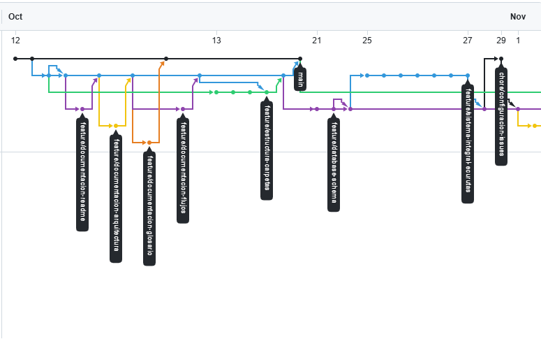
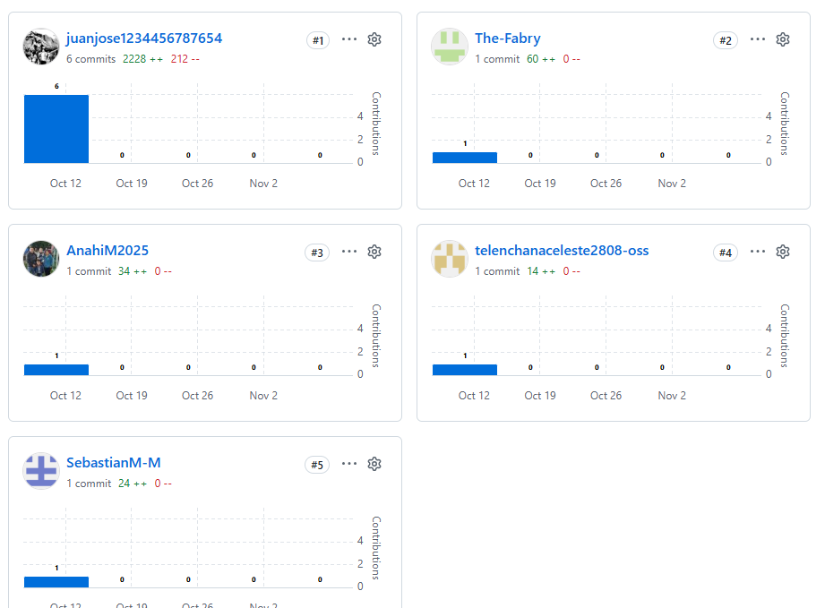
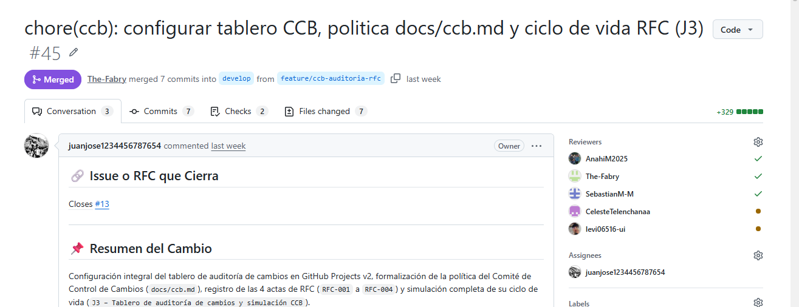
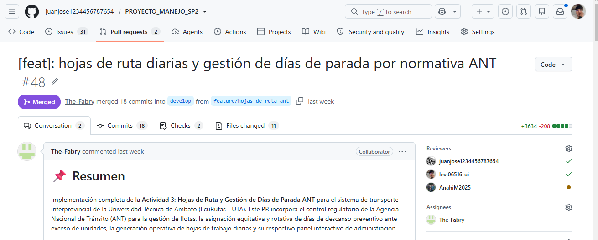
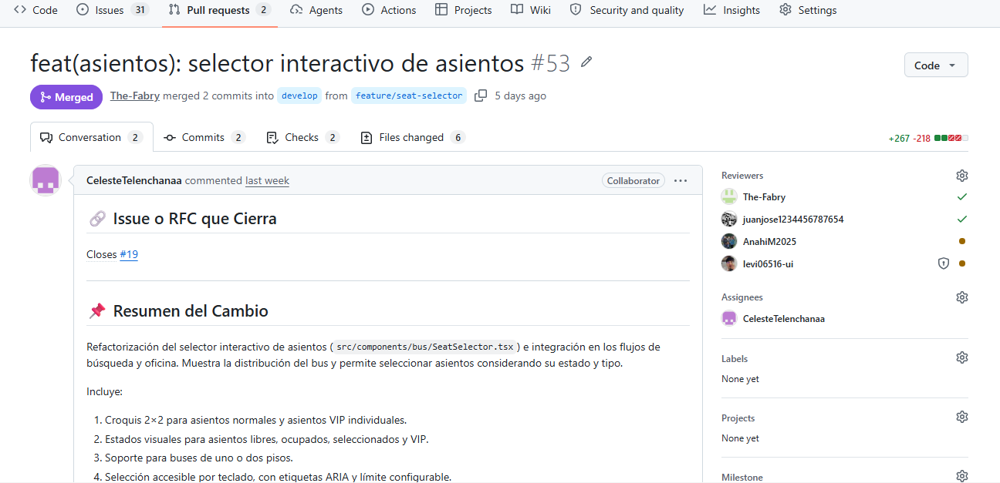
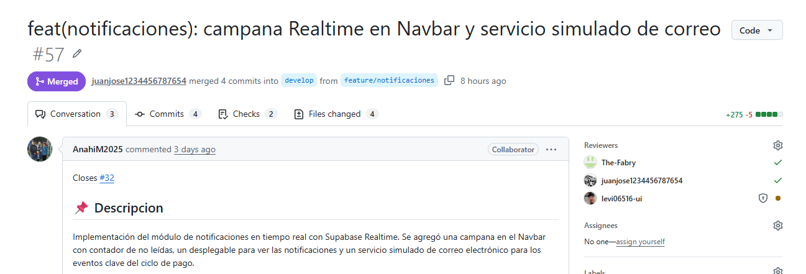
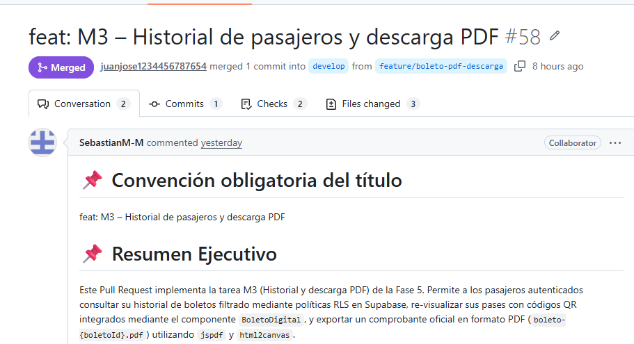

# Informe consolidado de evidencias Gitflow y auditoría CCB — Segundo Parcial

**Proyecto:** Sistema de Gestión y Venta de Pasajes Interprovinciales — PROYECTO_MANEJO_SP2  
**Repositorio:** [PROYECTO_MANEJO_SP2](https://github.com/juanjose1234456787654/PROYECTO_MANEJO_SP2)  
**Responsable de gestión de configuración:** Juan José Carvajal Jaya (`@juanjose1234456787654`)  
**Responsable de evidencias y auditoría:** Jeremy Guaman (`@levi06516-ui`)  
**Issue de entrega:** [#37](https://github.com/juanjose1234456787654/PROYECTO_MANEJO_SP2/issues/37)  
**Rama de trabajo:** `feature/docs-evidencias-gitflow`  
**Pull Request:** [#49 hacia `develop`](https://github.com/juanjose1234456787654/PROYECTO_MANEJO_SP2/pull/49)  
**Fecha de referencia de métricas:** 9 de noviembre de 2026  
**Fecha de la auditoría original del tablero:** 3 de noviembre de 2026

> **Alcance y verificación.** Este informe consolida dos documentos aportados por el equipo. Las métricas y los estados reflejan sus fechas de corte y **no constituyen una comprobación en tiempo real**. Las capturas se citan por rutas previstas: su existencia y legibilidad deben verificarse antes de entregar. Los estados del tablero del 3 de noviembre pueden diferir de los labels de las Issues revisados el 9 de noviembre.

## 1. Objetivo y alcance

Reunir en un único documento la evidencia de aplicación de Gitflow, las contribuciones de los seis integrantes, las revisiones de Pull Requests, el seguimiento de Issues, la configuración del tablero CCB, la trazabilidad de cuatro solicitudes de cambio y una auditoría de commits. El informe sirve de índice de evidencias para la Issue #37 y como soporte del PR #49.

## 2. Estrategia Gitflow

- **`main`:** rama estable destinada a liberaciones aprobadas.
- **`develop`:** rama de integración de funcionalidades revisadas y probadas.
- **`feature/*`:** ramas de trabajo creadas desde `develop` y propuestas de vuelta a `develop` mediante Pull Requests.
- **Revisión:** se requieren dos aprobaciones auténticas de cuentas distintas por PR, según la pauta del equipo. La fusión de un PR no prueba por sí sola el cierre de su Issue.

### 2.1. Gráfico de red de ramas

[Consultar red de ramas en GitHub](https://github.com/juanjose1234456787654/PROYECTO_MANEJO_SP2/network)

**Nota:** el primer borrador contenía la ruta errónea `./imagenes/imagenes2026-11-09_red-gitflow.png`; se ha normalizado. Si el nombre real del archivo es diferente, actualizar este enlace.

### 2.2. Gráfico de contribuidores

[Consultar Contributors](https://github.com/juanjose1234456787654/PROYECTO_MANEJO_SP2/graphs/contributors)

## 3. Matriz de contribuciones

Los commits se contaron en `develop`, agrupados por `author.login`; los PR corresponden a los fusionados en el repositorio y las Issues cerradas al conjunto de 31 Issues auditadas. **No son métricas limitadas exclusivamente al segundo parcial.**

| Integrante | GitHub | Commits en `develop` | PR mergeados | Issues cerrados |
|---|---|---:|---:|---:|
| Juan Carvajal | [@juanjose1234456787654](https://github.com/juanjose1234456787654) | 44 | 8 | 0 |
| Andrés Toasa | [@The-Fabry](https://github.com/The-Fabry) | 32 | 5 | 0 |
| Celeste Telenchana | [@CelesteTelenchanaa](https://github.com/CelesteTelenchanaa) | 1† | 4 | 0 |
| Anahí Morales | [@AnahiM2025](https://github.com/AnahiM2025) | 7 | 4 | 0 |
| Mateo Morales | [@SebastianM-M](https://github.com/SebastianM-M) | 8 | 4 | 0 |
| Jeremy Guaman | [@levi06516-ui](https://github.com/levi06516-ui) | 0‡ | 0 | 0 |

† Cuenta principal identificada; seis commits de un posible alias no confirmados. ‡ Sin commits en `develop` en el corte, aunque sí había trabajo en su rama.

**Método y cautelas:** el corte documentado registra 98 commits en `develop` y 25 PR fusionados. El total de commits por cuenta puede incluir merges realizados por un integrador. La cuenta `telenchanaceleste2808-oss` tiene seis commits adicionales cuya atribución a Celeste **no está confirmada**. Jeremy tenía commits en su rama de documentación, pero ninguno en `develop` al momento del corte. El número de commits de la rama puede haber cambiado con los commits posteriores de evidencias.

## 4. Evidencias de Pull Requests y revisiones

Se deben capturar PR reales que muestren el autor, el estado y al menos **dos revisiones Approved**. No se considera aprobado un PR por el simple hecho de estar fusionado.

| Integrante | PR de referencia | Imagen | Situación según los documentos |
|---|---|---|---|
| Juan | [#45](https://github.com/juanjose1234456787654/PROYECTO_MANEJO_SP2/pull/45) | `imagenes/2026-11-09_pr-juan.png` | Tres aprobaciones señaladas en el corte del 9/11 |
| Andrés | [#48](https://github.com/juanjose1234456787654/PROYECTO_MANEJO_SP2/pull/48) | `imagenes/2026-11-09_pr-andres.png` | Verificar dos aprobaciones |
| Celeste | [#53](https://github.com/juanjose1234456787654/PROYECTO_MANEJO_SP2/pull/53) | `imagenes/2026-11-09_pr-celeste.png` | Verificar dos aprobaciones |
| Anahí | [#57](https://github.com/juanjose1234456787654/PROYECTO_MANEJO_SP2/pull/57) | `imagenes/2026-11-09_pr-anahi.png` | Verificar dos aprobaciones |
| Mateo | [#58](https://github.com/juanjose1234456787654/PROYECTO_MANEJO_SP2/pull/58) | `imagenes/2026-11-09_pr-mateo.png` | Verificar dos aprobaciones |
| Jeremy | [#49](https://github.com/juanjose1234456787654/PROYECTO_MANEJO_SP2/pull/49) | `imagenes/2026-11-09_pr-jeremy.png` | Pendiente de verificar aprobaciones y fusión |

### Capturas de revisiones

## 5. Auditoría de Issues cerradas

En el corte documentado del 9/11 se registraban **0 Issues cerradas entre las 31 auditadas**, aunque existían PR fusionados. Debe actualizarse esta cifra si hubo cierres posteriores.

[Ver Issues cerradas](https://github.com/juanjose1234456787654/PROYECTO_MANEJO_SP2/issues?q=is%3Aissue+is%3Aclosed)

**Seguimiento:** la Issue [#13](https://github.com/juanjose1234456787654/PROYECTO_MANEJO_SP2/issues/13), relacionada con el tablero, figuraba abierta aunque su [PR #45](https://github.com/juanjose1234456787654/PROYECTO_MANEJO_SP2/pull/45) estaba fusionado. El cierre formal debe comprobarse aparte.

## 6. Tablero de gestión de configuración y CCB

**Tablero de referencia:** [GitHub Projects #1](https://github.com/users/juanjose1234456787654/projects/1).

### 6.1. Campos y configuración del tablero

El documento de auditoría del 3/11 describe los siguientes campos configurados en GitHub Projects v2:

| Campo | Tipo | Valores registrados |
|---|---|---|
| Status | Selección única | Propuesto; En revisión por CCB; Aprobado; Implementado; Rechazado |
| Responsable | Selección única | Juan; Andrés; Celeste; Anahí; Mateo; Jeremy |
| Fase | Selección única | Fases 1 a 6: Infraestructura, Negocio, UI, Pagos, QR y Cierre |
| Tipo | Selección única | Tarea; Epic; RFC |
| Orden | Número | 1 a 21 |

Los identificadores GraphQL originales se conservan en el documento fuente `auditoria-tablero-ccb.md` y no son necesarios para interpretar el tablero.

### 6.2. Ciclo de vida de una RFC

`Propuesto → En revisión por CCB → Aprobado → Implementado`, con posible resultado `Rechazado`. Las decisiones se respaldan con comentarios o actas, etiquetas de Issues y estados del tablero. Estos elementos **pueden no coincidir temporalmente**.

### 6.3. Trazabilidad de las cuatro RFC

La siguiente tabla recoge los **labels de Issues reportados el 9/11**, no una nueva lectura del campo `Status` del tablero.

| RFC | Issue | Responsable | Impacto | Label verificado (2026-11-09) | PR de desarrollo |
|---|---|---|---|---|---|
| RFC-001: Migrar de mockData a Supabase | [#26](https://github.com/juanjose1234456787654/PROYECTO_MANEJO_SP2/issues/26) | Juan | Alto | `ccb:implementado` | [#42](https://github.com/juanjose1234456787654/PROYECTO_MANEJO_SP2/pull/42) fusionado |
| RFC-002: Tarifa proporcional por tramos | [#27](https://github.com/juanjose1234456787654/PROYECTO_MANEJO_SP2/issues/27) | Andrés | Medio | `ccb:implementado` | [#46](https://github.com/juanjose1234456787654/PROYECTO_MANEJO_SP2/pull/46) fusionado |
| RFC-003: Firma HMAC-SHA256 de QR | [#28](https://github.com/juanjose1234456787654/PROYECTO_MANEJO_SP2/issues/28) | Mateo | Medio | `ccb:aprobado` | [#51](https://github.com/juanjose1234456787654/PROYECTO_MANEJO_SP2/pull/51) fusionado |
| RFC-004: Comprobantes y estados del pago | [#29](https://github.com/juanjose1234456787654/PROYECTO_MANEJO_SP2/issues/29) | Anahí | Pagos y gestión documental | `ccb:aprobado` | [#55](https://github.com/juanjose1234456787654/PROYECTO_MANEJO_SP2/pull/55) fusionado |

**Diferencia entre cortes:** la auditoría del 3/11 indicaba RFC-002 como **Aprobado**, mientras el corte del 9/11 registra su etiqueta `ccb:implementado` y PR #46 fusionado. Las RFC-003 y RFC-004 tenían PR de implementación fusionados, pero sus etiquetas continuaban como `ccb:aprobado`. Antes de la entrega se debe contrastar la vista actual del tablero y documentar cualquier transición formal.

### 6.4. Actas y documentos de RFC

- [RFC-001 — Migración a Supabase](../cambios/RFC-001-migracion-supabase-real.md)
- [RFC-002 — Tarifa por tramos](../cambios/RFC-002-tarifa-proporcional-tramos.md)
- [RFC-003 — Firma HMAC del QR](../cambios/RFC-003-firma-hmac-qr-boleto.md)
- [RFC-004 — Comprobantes y estados del pago](../cambios/RFC-004-contenedor-unico-comprobantes.md)

### 6.5. Captura del tablero

Si el tablero es privado o inaccesible para un revisor, adjuntar una captura auténtica realizada por una cuenta autorizada y conservar enlaces a las cuatro Issues. Una captura de Issues no sustituye por sí sola la evidencia visual del Project.

## 7. Inventario de los 31 ítems auditados

Esta matriz procede de la auditoría del **3/11**. Los estados no deben interpretarse como actualizados al 9/11.

| # Issue | Orden | Tipo | Fase | Responsable | Título | Estado en Tablero |
|:-------:|:-----:|:----:|------|-------------|--------|:-----------------:|
| ****#11**** | 01 | Tarea | Fase 1 – Infraestructura | Juan | `[01/18][Juan] J2 – Integración real de Supabase` | `Implementado` |
| ****#12**** | 02 | Tarea | Fase 1 – Infraestructura | Juan | `[02/18][Juan] J1 – Archivos formales de configuración y plantillas` | `En revisión por CCB` |
| ****#13**** | 03 | Tarea | Fase 1 – Infraestructura | Juan | `[03/18][Juan] J3 – Tablero de auditoría de cambios y simulación CCB` | `En revisión por CCB` |
| ****#14**** | 04 | Tarea | Fase 2 – Negocio | Andrés | `[04/18][Andrés] A1 – Paradas intermedias y cálculo de tramo` | `Propuesto` |
| ****#15**** | 05 | Tarea | Fase 2 – Negocio | Andrés | `[05/18][Andrés] A2 – Validación de cédula y descuentos ANT` | `Propuesto` |
| ****#16**** | 06 | Tarea | Fase 2 – Negocio | Andrés | `[06/18][Andrés] A3 – Hojas de ruta y días de parada` | `Propuesto` |
| ****#17**** | 07 | Tarea | Fase 3 – UI | Celeste | `[07/18][Celeste] C1 – Filtros avanzados en el buscador` | `Propuesto` |
| ****#18**** | 08 | Tarea | Fase 3 – UI | Celeste | `[08/18][Celeste] C2 – Panel de configuración global` | `Propuesto` |
| ****#19**** | 09 | Tarea | Fase 3 – UI | Celeste | `[09/18][Celeste] C3 – Selector interactivo de asientos` | `Propuesto` |
| ****#30**** | 10 | Tarea | Fase 4 – Pagos | Anahí | `[10/18][Anahí] N1 – Comprobantes en proceso de pago` | `Propuesto` |
| ****#31**** | 11 | Tarea | Fase 4 – Pagos | Anahí | `[11/18][Anahí] N2 – Panel del oficinista` | `Propuesto` |
| ****#32**** | 12 | Tarea | Fase 4 – Pagos | Anahí | `[12/18][Anahí] N3 – Notificaciones en la aplicación y por correo` | `Propuesto` |
| ****#33**** | 13 | Tarea | Fase 5 – QR | Mateo | `[13/18][Mateo] M1 – QR firmado HMAC` | `Propuesto` |
| ****#34**** | 14 | Tarea | Fase 5 – QR | Mateo | `[14/18][Mateo] M2 – Escáner del chofer` | `Propuesto` |
| ****#35**** | 15 | Tarea | Fase 5 – QR | Mateo | `[15/18][Mateo] M3 – Historial y descarga PDF` | `Propuesto` |
| ****#36**** | 16 | Tarea | Fase 6 – Cierre | Jeremy | `[16/18][Jeremy] D1 – Informe técnico UTA` | `Propuesto` |
| ****#37**** | 17 | Tarea | Fase 6 – Cierre | Jeremy | `[17/18][Jeremy] D2 – Evidencias Gitflow` | `Propuesto` |
| ****#38**** | 18 | Tarea | Fase 6 – Cierre | Jeremy | `[18/18][Jeremy] D3 – Diapositivas y defensa` | `Propuesto` |
| ****#39**** | 19 | Tarea | Fase 1 – Infraestructura | Juan | `[CI] Integración continua: validación de código, tipado y compilación en cada PR` | `Propuesto` |
| ****#40**** | 20 | Tarea | Fase 1 – Infraestructura | Juan | `[GITFLOW] Verificar reglas de protección de main y develop` | `Propuesto` |
| ****#41**** | 21 | Tarea | Fase 6 – Cierre | Juan | `[QA] Pruebas de integración final y demostración en develop` | `Propuesto` |
| ****#20–#25**** | — | Epic | Fases 1 a 6 | Todos | Épicas de las 6 fases del proyecto | `Propuesto` |
| ****#26**** | — | RFC | Fase 1 – Infraestructura | Juan | `[RFC-001] Migrar de mockData a Supabase real` | `Implementado` |
| ****#27**** | — | RFC | Fase 2 – Negocio | Andrés | `[RFC-002] Tarifa proporcional por tramos en paradas intermedias` | `Aprobado` |
| ****#28**** | — | RFC | Fase 5 – QR | Mateo | `[RFC-003] Firma HMAC-SHA256 del QR del boleto` | `Aprobado` |
| ****#29**** | — | RFC | Fase 4 – Pagos | Anahí | `[RFC-004] Contenedor único de comprobantes y máquina de estados del pago` | `Aprobado` |

## 8. Auditoría de commits y trazabilidad

### 8.1. Muestra histórica de commits (`develop`)

La auditoría original registra los siguientes commits con sus tipos y alcances. Se mantiene su contenido como **muestra histórica**, no como listado exhaustivo de todos los integrantes ni como prueba de cobertura de todas las fases.

| Fecha | Integrante | Commit Hash | Tipo | Alcance | Descripción |
| :---: | :--- | :---: | :---: | :---: | :--- |
| `2026-11-01` | Juan Carvajal | `2ebf186` | `fix` | `supabase` | ajustar exports de tipos en src/lib/types/index.ts |
| `2026-11-01` | Juan Carvajal | `bb945af` | `chore` | `supabase` | eliminar mockData.ts tras migrar a consultas reales de Supabase |
| `2026-11-01` | Juan Carvajal | `6482a17` | `refactor` | `supabase` | migrar imports de tipos desde mockData hacia src/lib/types |
| `2026-11-01` | Juan Carvajal | `4e0dcda` | `feat` | `supabase` | reescribir dataService con consultas reales a Supabase y Result\<T> |
| `2026-11-01` | Juan Carvajal | `00b0b8a` | `feat` | `supabase` | publicar tipos compartidos y Result\<T> en src/lib/types/index.ts |
| `2026-11-01` | Juan Carvajal | `8f6495b` | `chore` | `supabase` | documentar variables de entorno en .env.example y unificar cliente |
| `2026-11-01` | Juan Carvajal | `7489dd7` | `merge` | `PR #10` | Merge pull request #10 from feature/configuracion-issues |
| `2026-10-29` | Juan Carvajal | `7b3035b` | `chore` | `config` | agregar plantillas tarea_actividad y rfc_change para segundo parcial |
| `2026-10-27` | Juan Carvajal | `c510314` | `merge` | `PR #9` | Merge pull request #9 from feature/sistema-integral-ecurutas |
| `2026-10-27` | Juan Carvajal | `8c39583` | `fix` | `auth` | resuelve constraint NOT NULL en password de Usuario y optimiza flujo de registro/login |
| `2026-10-25` | Juan Carvajal | `1ad93f2` | `feat` | `modules-ci` | activa los 12 modulos de dominio, pipeline CI y documentacion ITIL RFC-001 |
| `2026-10-25` | Juan Carvajal | `48082f6` | `feat` | `reportes-rutas` | agrega panel analitico de reportes, navegacion directa por roles y subrutas completas |
| `2026-10-25` | Juan Carvajal | `8250330` | `feat` | `oficina-chofer` | taquilla de ventanilla con descuentos legales y escaneo QR en tiempo real para chofer |
| `2026-10-25` | Juan Carvajal | `7bee4a2` | `feat` | `cooperativa-admin` | paneles de administracion de flota, frecuencias ANT, rutas y gestion de usuarios por roles |
| `2026-10-25` | Juan Carvajal | `09f47a5` | `feat` | `pasajero` | implementa catalogo interactivo de busqueda, mapa visual de asientos y casillero de boletos con QR |
| `2026-10-25` | Juan Carvajal | `de3cce4` | `feat` | `setup` | inicializa aplicacion Next.js 15, autenticacion Supabase SSR y middleware por roles |
| `2026-10-21` | Andrés Toasa | `a875233` | `merge` | `PR #8` | Merge pull request #8 from feature/database-schema |
| `2026-10-21` | Andrés Toasa | `2734173` | `docs` | `db` | agrega documentacion tecnica de la arquitectura de base de datos |
| `2026-10-21` | Andrés Toasa | `d8c8d4e` | `feat` | `db` | agrega script DDL inicial de Supabase |
| `2026-10-13` | Juan Carvajal | `e7ab0ca` | `merge` | `PR #6` | Merge pull request #6 from feature/estructura-carpetas |
| `2026-10-13` | Juan Carvajal | `9e4feba` | `docs` | `merge` | resuelve conflicto en README.md integrando cambios de develop |
| `2026-10-13` | Juan Carvajal | `f0e79ce` | `docs` | `repo` | actualiza PULL_REQUEST_BODY con documentacion ITIL y equipo completo |
| `2026-10-13` | Juan Carvajal | `8340d9c` | `docs` | `repo` | integra documentacion ITIL, matriz de integrantes y portal de reportes |
| `2026-10-13` | Juan Carvajal | `fc436db` | `feat` | `github` | implementa plantillas para issues y prs y actualiza politicas de seguridad con supabase |
| `2026-10-12` | Mateo Morales | `68520ac` | `merge` | `PR #5` | Merge pull request #5 from feature/documentacion-flujos |
| `2026-10-12` | Mateo Morales | `8114cae` | `docs` | `flujos` | agrega explicacion paso a paso de los flujos de compra y abordaje |
| `2026-10-12` | Anahí Morales | `ad47af1` | `merge` | `PR #3` | Merge pull request #3 from feature/documentacion-arquitectura |
| `2026-10-12` | Anahí Morales | `2514703` | `docs` | `arquitectura` | agrega explicacion de la estructura y modelo de base de datos |
| `2026-10-12` | Andrés Toasa | `03a8745` | `merge` | `PR #2` | Merge pull request #2 from feature/documentacion-readme |
| `2026-10-12` | Andrés Toasa | `efc3e59` | `docs` | `readme` | agrega estructura y documentacion inicial del README.md |
| `2026-10-12` | Juan Carvajal | `0d44d00` | `merge` | `PR #1` | Merge pull request #1 from feature/estructura-carpetas |

### 8.2. Muestra complementaria del corte del 9/11

| Fecha de referencia | Integrante | Commit hash | Tipo | Alcance | Descripción |
|---|---|---|---|---|---|
| 2026-11-09 | Juan (integrador) | [`809a3e1`](https://github.com/juanjose1234456787654/PROYECTO_MANEJO_SP2/commit/809a3e10ca416e7b6d4bb2c9a8c20f4b5acc2aea) | merge | Notificaciones | Merge del PR #57 |
| 2026-11-09 | Mateo | [`33765e8`](https://github.com/juanjose1234456787654/PROYECTO_MANEJO_SP2/commit/33765e85b0a10aeaab5d155635f41a3a86d53e4e) | feat | Boletos | Historial de pasajeros y descarga de PDF |
| 2026-11-09 | Anahí | [`89e199f`](https://github.com/juanjose1234456787654/PROYECTO_MANEJO_SP2/commit/89e199f3a160863bff3f0810be0007cbec1958ea) | feat | Notificaciones | Campana Realtime y correo |
| 2026-11-03 | Jeremy | [`9351097`](https://github.com/juanjose1234456787654/PROYECTO_MANEJO_SP2/commit/935109755db4954edc64b65cb04d6ba58d94ee57) | docs | Evidencias | Auditoría Gitflow y trazabilidad CCB (rama feature) |

Las fechas exactas y los hashes deben cotejarse en GitHub antes de usar estas filas como evidencia definitiva. Para la Issue #37 también se debe comprobar cobertura de **al menos cuatro fases de desarrollo** y participación de los seis integrantes.

## 9. Inventario y organización de capturas

Todas las imágenes se organizan bajo `docs/evidencias/imagenes/`, con el formato `YYYY-MM-DD_descripcion.png`. Las rutas de este documento suponen que las capturas se guardaron con los nombres indicados; no se ha verificado su existencia en el repositorio.

| Archivo | Qué debe mostrar |
|---|---|
| `2026-11-09_red-gitflow.png` | Red de ramas `main`, `develop` y `feature/*` |
| `2026-11-09_contribuidores.png` | Gráfico de contribuidores de GitHub |
| `2026-11-09_pr-juan.png` | PR de Juan y aprobaciones |
| `2026-11-09_pr-andres.png` | PR de Andrés y aprobaciones |
| `2026-11-09_pr-celeste.png` | PR de Celeste y aprobaciones |
| `2026-11-09_pr-anahi.png` | PR de Anahí y aprobaciones |
| `2026-11-09_pr-mateo.png` | PR de Mateo y aprobaciones |
| `2026-11-09_pr-jeremy.png` | PR de Jeremy y aprobaciones |
| `2026-11-09_issues-cerrados.png` | Vista de Issues filtrada por Closed |
| `2026-11-09_tablero-ccb.png` | Tablero CCB y cuatro RFC |

Si alguna captura fue tomada en otra fecha, **renombrar el archivo y actualizar su referencia** en este documento. No simular capturas ni aprobaciones.

## 10. Procedimiento de comprobación

1. Abrir [Network](https://github.com/juanjose1234456787654/PROYECTO_MANEJO_SP2/network) y comprobar las ramas.
2. Abrir [Contributors](https://github.com/juanjose1234456787654/PROYECTO_MANEJO_SP2/graphs/contributors) y verificar las cuentas y posibles alias.
3. Revisar las aprobaciones de los seis PR citados; no asumir que una fusión acredita dos aprobaciones.
4. Revisar el filtro [Closed](https://github.com/juanjose1234456787654/PROYECTO_MANEJO_SP2/issues?q=is%3Aissue+is%3Aclosed) y actualizar el conteo.
5. Revisar el [Project CCB](https://github.com/users/juanjose1234456787654/projects/1), sus cuatro RFC y los estados actuales.
6. Abrir las imágenes en la vista previa Markdown y verificar que se carguen y sean legibles.
7. Confirmar la cobertura de fases y la relación de los commits con sus autores.

## 11. Lista de verificación para la entrega

- [ ] Existen al menos ocho capturas reales, legibles y con fecha en el nombre.
- [ ] Las rutas de las imágenes funcionan en el README de GitHub.
- [ ] Network y Contributors están documentados.
- [ ] Hay un PR por cada integrante y dos aprobaciones verificadas por PR.
- [ ] La captura de Issues cerradas coincide con el estado actual.
- [ ] El tablero CCB muestra las cuatro RFC y sus estados vigentes.
- [ ] La auditoría acredita al menos cuatro fases y a los seis integrantes.
- [ ] La dependencia [#13](https://github.com/juanjose1234456787654/PROYECTO_MANEJO_SP2/issues/13) fue revisada.
- [ ] El [PR #49](https://github.com/juanjose1234456787654/PROYECTO_MANEJO_SP2/pull/49) cuenta con las revisiones requeridas y está listo para integrarse en `develop`.
- [ ] El texto del PR conserva `Closes #37` y se comprueba el cierre de la Issue cuando corresponda.

## 12. Conclusiones

La documentación integrada ofrece una estructura trazable de Gitflow, una matriz cuantitativa de aportaciones, referencias a revisiones de PR, registro de Issues y auditoría del CCB. La principal limitación es la diferencia entre los cortes del 3 y 9 de noviembre y la necesidad de comprobar las capturas, aprobaciones y estados actuales antes de dar la entrega por concluida. La integración en `develop` debe realizarse únicamente después de esa revisión.
