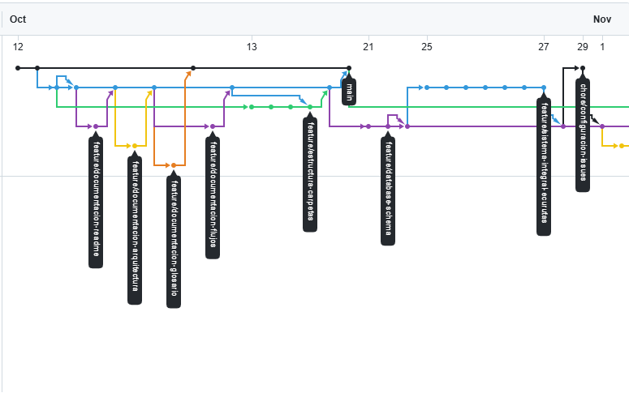
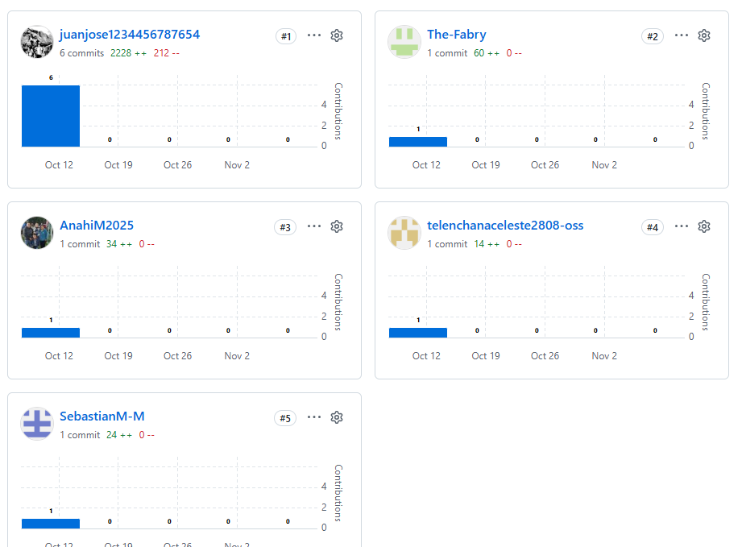

# Evidencias Gitflow — Segundo Parcial

**Repositorio:** [PROYECTO_MANEJO_SP2](https://github.com/juanjose1234456787654/PROYECTO_MANEJO_SP2)  
**Responsable:** Jeremy Guaman (`@levi06516-ui`)  
**Issue:** [#37](https://github.com/juanjose1234456787654/PROYECTO_MANEJO_SP2/issues/37)  
**Rama:** `feature/docs-evidencias-gitflow`  
**Pull request:** [#49](https://github.com/juanjose1234456787654/PROYECTO_MANEJO_SP2/pull/49) a `develop`  
**Fecha de corte:** 2026-11-09

> Las métricas corresponden al estado consultado; no representan necesariamente el estado final del parcial. No se han adjuntado capturas y no se deben marcar como completas hasta guardarlas.
## 1. Evidencia del gráfico de ramas Gitflow

La siguiente captura muestra la estructura de ramas
del proyecto y su integración mediante Gitflow.

## Evidencia 2: Gráfico de contribuidores

La siguiente captura presenta las contribuciones registradas
por GitHub en el repositorio del proyecto.

## 1. Estrategia de ramificación Gitflow

- `main`: rama estable para versiones de liberación.
- `develop`: rama de integración de cambios ya revisados.
- `feature/*`: ramas individuales para desarrollo y documentación; deben integrarse en `develop` mediante pull requests con las aprobaciones exigidas.
- La evidencia de los merges se conserva en los PR. **Un PR fusionado no significa automáticamente que la issue correspondiente esté cerrada.**

## 2. Matriz de contribuciones

| Integrante | GitHub | Commits en `develop` | PR mergeados | Issues cerrados |
|---|---|---:|---:|---:|
| Juan Carvajal | [@juanjose1234456787654](https://github.com/juanjose1234456787654) | 44 | 8 | 0 |
| Andrés Toasa | [@The-Fabry](https://github.com/The-Fabry) | 32 | 5 | 0 |
| Celeste Telenchana | [@CelesteTelenchanaa](https://github.com/CelesteTelenchanaa) | 1* | 4 | 0 |
| Anahí Morales | [@AnahiM2025](https://github.com/AnahiM2025) | 7 | 4 | 0 |
| Mateo Morales | [@SebastianM-M](https://github.com/SebastianM-M) | 8 | 4 | 0 |
| Jeremy Guaman | [@levi06516-ui](https://github.com/levi06516-ui) | 0** | 0 | 0 |

**Método de conteo:** se consultaron los 98 commits devueltos para `develop` por la API de GitHub, agrupados por `author.login`. Se contabilizaron los 25 PR con `merged_at` no nulo y los cierres de las 31 issues registradas en el proyecto. **Son métricas de distintos alcances:** commits en `develop`, PR fusionados en todo el repositorio e issues del proyecto; incluye actividad anterior al segundo parcial. Las cifras de commits incluyen commits de merge asociados al integrador.

* Seis commits adicionales están asociados a la cuenta `telenchanaceleste2808-oss`; confirmar si corresponde a Celeste antes de sumarlos.  
** Jeremy tiene al menos tres commits en su rama `feature/docs-evidencias-gitflow`, pero ninguno estaba en `develop` en este corte.

## 3. Evidencias de Gitflow pendientes de captura

**Formato:** `YYYY-MM-DD_descripcion.png`, reemplazando la fecha por el día real de la captura. Guardar todas las imágenes directamente en `docs/evidencias/`.

| Nombre sugerido | Evidencia | Fuente | Estado |
|---|---|---|---|
| `2026-11-09_red-ramas.png` | Gráfico de red de ramas `main`, `develop`, `feature/*` | [Network](https://github.com/juanjose1234456787654/PROYECTO_MANEJO_SP2/network) | Pendiente |
| `2026-11-09_contribuidores.png` | Gráfico de contribuidores de GitHub | [Contributors](https://github.com/juanjose1234456787654/PROYECTO_MANEJO_SP2/graphs/contributors) | Pendiente |
| `2026-11-09_pr-juan.png` | PR de Juan, 2 aprobaciones visibles | [PR #45](https://github.com/juanjose1234456787654/PROYECTO_MANEJO_SP2/pull/45) | Pendiente de captura; 3 aprobaciones comprobadas |
| `2026-11-09_pr-andres.png` | PR de Andrés, verificar 2 aprobaciones | [PR #48](https://github.com/juanjose1234456787654/PROYECTO_MANEJO_SP2/pull/48) | Pendiente |
| `2026-11-09_pr-celeste.png` | PR de Celeste, verificar 2 aprobaciones | [PR #53](https://github.com/juanjose1234456787654/PROYECTO_MANEJO_SP2/pull/53) | Pendiente |
| `2026-11-09_pr-anahi.png` | PR de Anahí, verificar 2 aprobaciones | [PR #57](https://github.com/juanjose1234456787654/PROYECTO_MANEJO_SP2/pull/57) | Pendiente |
| `2026-11-09_pr-mateo.png` | PR de Mateo, verificar 2 aprobaciones | [PR #58](https://github.com/juanjose1234456787654/PROYECTO_MANEJO_SP2/pull/58) | Pendiente |
| `2026-11-09_pr-jeremy.png` | PR de Jeremy, verificar 2 aprobaciones y merge | [PR #49](https://github.com/juanjose1234456787654/PROYECTO_MANEJO_SP2/pull/49) | Pendiente: abierto, cambios solicitados previamente |
| `2026-11-09_issues-closed.png` | Vista de issues con filtro Closed (aunque no haya resultados) | [Issues Closed](https://github.com/juanjose1234456787654/PROYECTO_MANEJO_SP2/issues?q=is%3Aissue+is%3Aclosed) | Pendiente |
| `2026-11-09_tablero-ccb.png` | Las 4 RFC y sus estados actuales en Projects | [Tablero CCB](https://github.com/users/juanjose1234456787654/projects/1) | Pendiente |

No simular imágenes ni marcas de aprobación: deben ser capturas auténticas de GitHub, preferentemente con las cabeceras y estados legibles.

## 4. Ciclo de vida del CCB

Estados establecidos: **Propuesto → En revisión por CCB → Aprobado → Implementado**, con opción de **Rechazado**. Las decisiones deben comprobarse mediante comentarios/actas del CCB, labels de issues y la vista real de GitHub Projects; esos indicadores pueden diferir.

| RFC | Issue | Responsable | Impacto | Label verificado (2026-11-09) | PR de desarrollo |
|---|---|---|---|---|---|
| RFC-001: Migrar de mockData a Supabase | [#26](https://github.com/juanjose1234456787654/PROYECTO_MANEJO_SP2/issues/26) | Juan | Alto | `ccb:implementado` | [#42](https://github.com/juanjose1234456787654/PROYECTO_MANEJO_SP2/pull/42) fusionado |
| RFC-002: Tarifa proporcional por tramos | [#27](https://github.com/juanjose1234456787654/PROYECTO_MANEJO_SP2/issues/27) | Andrés | Medio | `ccb:implementado` | [#46](https://github.com/juanjose1234456787654/PROYECTO_MANEJO_SP2/pull/46) fusionado |
| RFC-003: Firma HMAC-SHA256 de QR | [#28](https://github.com/juanjose1234456787654/PROYECTO_MANEJO_SP2/issues/28) | Mateo | Medio | `ccb:aprobado` | [#51](https://github.com/juanjose1234456787654/PROYECTO_MANEJO_SP2/pull/51) fusionado |
| RFC-004: Comprobantes y estados del pago | [#29](https://github.com/juanjose1234456787654/PROYECTO_MANEJO_SP2/issues/29) | Anahí | Pagos y gestión documental | `ccb:aprobado` | [#55](https://github.com/juanjose1234456787654/PROYECTO_MANEJO_SP2/pull/55) fusionado |

**Observación de auditoría:** el estado «fusionado» de una implementación no implica que la RFC se haya movido formalmente a «Implementado» en Projects. Confirmar y documentar la decisión del CCB. El tablero original se encuentra en [Projects #1](https://github.com/users/juanjose1234456787654/projects/1).

## 5. Registro de auditoría de commits

Tabla de muestra basada en commits verificados; ampliar con las cinco fases y los seis integrantes al cierre.

| Fecha de referencia | Integrante | Commit hash | Tipo | Alcance | Descripción |
|---|---|---|---|---|---|
| 2026-11-09 | Juan (integrador) | [`809a3e1`](https://github.com/juanjose1234456787654/PROYECTO_MANEJO_SP2/commit/809a3e10ca416e7b6d4bb2c9a8c20f4b5acc2aea) | merge | Notificaciones | Merge del PR #57 |
| 2026-11-09 | Mateo | [`33765e8`](https://github.com/juanjose1234456787654/PROYECTO_MANEJO_SP2/commit/33765e85b0a10aeaab5d155635f41a3a86d53e4e) | feat | Boletos | Historial de pasajeros y descarga de PDF |
| 2026-11-09 | Anahí | [`89e199f`](https://github.com/juanjose1234456787654/PROYECTO_MANEJO_SP2/commit/89e199f3a160863bff3f0810be0007cbec1958ea) | feat | Notificaciones | Campana Realtime y correo |
| 2026-11-03 | Jeremy | [`9351097`](https://github.com/juanjose1234456787654/PROYECTO_MANEJO_SP2/commit/935109755db4954edc64b65cb04d6ba58d94ee57) | docs | Evidencias | Auditoría Gitflow y trazabilidad CCB (rama feature) |

*Fechas de referencia: comprobar los timestamps exactos de cada commit individual antes de la entrega final.*

## 6. Procedimiento de exportación

1. Abrir **Insights → Network** y guardar la gráfica con las ramas `feature/*` visibles.
2. Abrir **Insights → Contributors**; capturar el panel y documentar posibles aliases de autor.
3. Abrir el PR de cada integrante y buscar dos revisiones auténticas con estado **Approved**, de dos cuentas distintas.
4. Abrir **Issues** con el filtro **Closed**; capturar el estado real (actualmente 0).
5. Abrir **Projects #1**; filtrar las cuatro RFC y capturar sus estados; si han cambiado, actualizar esta tabla antes de entregar.
6. Poner los archivos en esta carpeta, usar la fecha real y revisar que sean legibles.

## 7. Checklist de cumplimiento

- [ ] Al menos ocho capturas PNG reales con fecha en el nombre.
- [x] Documento README e inventario de evidencias.
- [ ] Capturas de Network y Contributors.
- [ ] Un PR documentado de cada integrante con dos aprobaciones verificadas.
- [ ] Captura de la vista de issues cerrados.
- [ ] Captura del tablero CCB con las cuatro RFC.
- [ ] Evidencias de al menos cuatro de las cinco fases de desarrollo.
- [ ] Dependencia [#13](https://github.com/juanjose1234456787654/PROYECTO_MANEJO_SP2/issues/13) cerrada: su PR #45 está fusionado, pero la issue sigue abierta.
- [ ] PR [#49](https://github.com/juanjose1234456787654/PROYECTO_MANEJO_SP2/pull/49) aprobado por dos revisores y fusionado a `develop`, con `Closes #37`.

**Documento complementario existente en la rama:** [`auditoria-tablero-ccb.md`](auditoria-tablero-ccb.md), elaborado con corte del 3 de noviembre de 2026. Sus estados no deben considerarse finales sin actualización.
