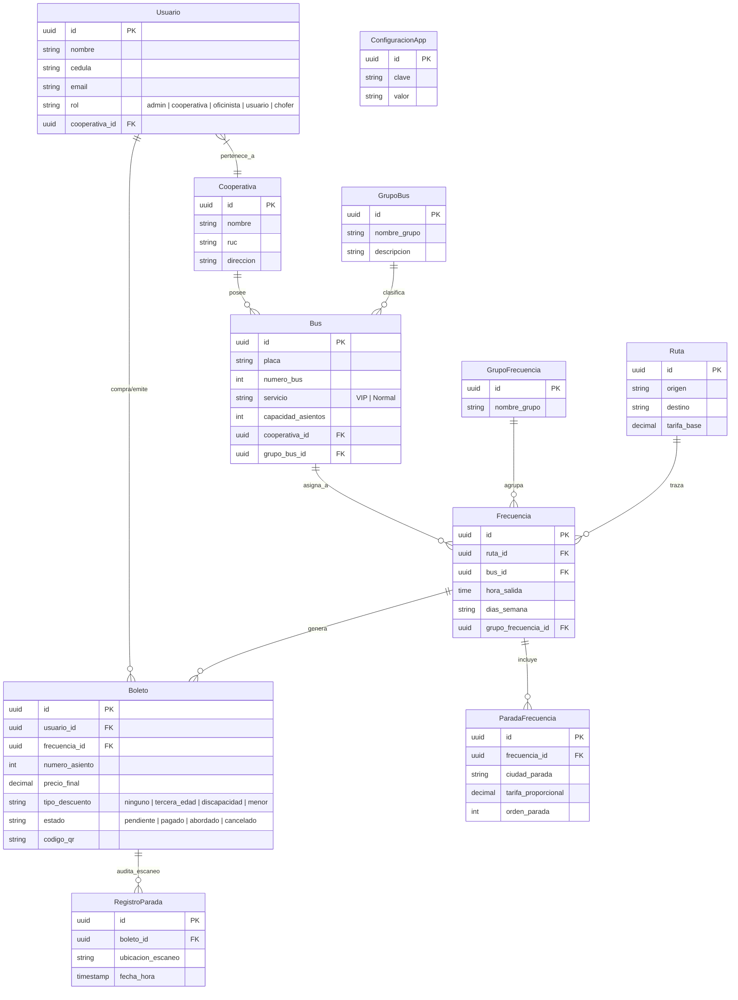

# 📄 INFORME TÉCNICO OFICIAL - SISTEMA DE GESTIÓN Y VENTA DE PASAJES INTERPROVINCIALES
**Universidad Técnica de Ambato (UTA)**  
**Facultad de Ingeniería en Sistemas, Electrónica e Industrial**  
**Carrera de Ingeniería en Software / Computación**  
**Asignatura:** Gestión de Software (Segundo Parcial - SP2)

---

## 1. Portada

* **Título del Proyecto:** Sistema de Gestión y Venta de Pasajes Interprovinciales (Cooperativa Ambato Express)
* **Docente:** Ing. Jara Moya Santiago David
* **Fecha:** 2 de Noviembre de 2026
* **Integrantes del Equipo de Desarrollo:**
  1. **Juan Carvajal** - Líder del Equipo / Configuration Manager (Infraestructura, Supabase, Auth, RLS)
  2. **Jeremy Guaman** (`@levi06516-ui`) - Coordinador de Configuración (Documentación e Informe Técnico UTA)
  3. **Andrés Toasa** - Desarrollador (Lógica de negocio ANT, motor tarifario, reserva y asientos)
  4. **Celeste Telenchana** - Desarrolladora (Diseño de interfaz de usuario UI/UX, Tailwind CSS)
  5. **Anahí Morales** - Desarrolladora (Módulo de Checkout, pasarela y comprobación de pagos)
  6. **Mateo Morales** - Desarrollador (Módulo de pases digitales, código QR y escaneo de abordaje)

---

## 2. Objetivos

### 2.1 Objetivo General
Desarrollar e implementar una plataforma web integral alineada a estándares de calidad de software y gestión de configuración ITIL para automatizar la venta de pasajes, la gestión operativa de frecuencias y el control de abordaje en el transporte interprovincial ecuatoriano.

### 2.2 Objetivos Específicos
* Centralizar la gestión operativa de cooperativas, flota vehicular, rutas y frecuencias con soporte para paradas intermedias.
* Automatizar el cálculo de tarifas e implementación estricta de descuentos normativos dictaminados por la Agencia Nacional de Tránsito (ANT).
* Implementar un mecanismo digital de validación de abordaje mediante la generación y lectura en tiempo real de códigos QR dinámicos.
* Garantizar la trazabilidad del código y la gobernanza del proyecto mediante el marco ITIL (SACM, Change Management, Release Management) y la metodología Gitflow.

---

## 3. Arquitectura del Sistema

### 3.1 Stack Tecnológico
* **Frontend:** Next.js (App Router), React, TypeScript (modo estricto), Tailwind CSS.
* **Backend & APIs:** Next.js Server Components, Server Actions y API Routes.
* **Base de Datos & Seguridad:** Supabase (PostgreSQL, Supabase Auth, Supabase Storage, Row Level Security - RLS).
* **Gobernanza y Versionado:** Gitflow, GitHub Issues, Conventional Commits y Marco ITIL.

### 3.2 Diagrama Entidad-Relación (11 Tablas PascalCase)



---

## 4. Módulos Implementados

| Módulo | Responsable | Descripción Funcional |
| :--- | :--- | :--- |
| **M1: Infraestructura y Supabase** | Juan Carvajal | Despliegue de la base de datos relacional PostgreSQL con las 11 tablas en PascalCase, políticas de aislamiento Row Level Security (RLS), autenticación con RBAC y configuración de Supabase Storage. |
| **M2: Lógica de Negocio ANT** | Andrés Toasa | Algoritmo de tarificación proporcional para paradas intermedias, motor de descuentos normativos (50% tercera edad, discapacidad, menores), matriz de días de parada y selector de asientos. |
| **M3: UI y Configuración** | Celeste Telenchana | Diseño del sistema de diseño (Design System) con Tailwind CSS, interfaz responsiva y prototipado de vistas según los 5 roles del sistema. |
| **M4: Checkout y Pagos** | Anahí Morales | Implementación de la pasarela de compra, validación de transferencias bancarias, carga de comprobantes y flujo de confirmación de transacción. |
| **M5: QR y Escaneo** | Mateo Morales | Generación del pase digital vectorial en formato QR, desarrollo del visor/escáner para el chofer y trazabilidad de abordaje en la tabla `RegistroParada`. |
| **M6: Documentación** | Jeremy Guaman | Coordinación de la gestión de configuración, elaboración del informe técnico UTA, auditoría del cumplimiento de estándares Gitflow y control del tablero de auditoría. |

---

## 5. Diagrama Entidad-Relación (Detalle de Integridad)

El esquema de la base de datos se fundamenta en las 11 tablas definidas bajo convenciones estrictas de nombres en PascalCase en Supabase:

1. `Usuario`: Entidad de usuarios con autenticación y asignación de rol (`admin`, `cooperativa`, `oficinista`, `usuario`, `chofer`).
2. `Cooperativa`: Entidad institucional con identificación jurídica (RUC).
3. `GrupoBus`: Clasificación funcional de flotas de transporte.
4. `Bus`: Unidades físicas asignadas a cooperativas y grupos.
5. `Ruta`: Traza geográfica base (Origen - Destino).
6. `GrupoFrecuencia`: Agrupación estratégica de itinerarios.
7. `Frecuencia`: Programación operativa (horarios y días de salida).
8. `ParadaFrecuencia`: Puntos intermedios de parada con tarificación proporcional.
9. `Boleto`: Comprobante de viaje y pase de abordaje emitido.
10. `RegistroParada`: Registro auditable de lectura e inspección de boletos en ruta.
11. `ConfiguracionApp`: Parámetros globales y variables del sistema.

---

## 6. Reglas de Negocio ANT

El desarrollo del motor de liquidación y emisión de boletos se alinea formalmente a la Ley Orgánica de Transporte Terrestre, Tránsito y Seguridad Vial (LOTTTSV) y a los reglamentos emanados por la Agencia Nacional de Tránsito (ANT):

1. **Paradas Intermedias:** Las tarifas de las sub-rutas se calculan en la tabla `ParadaFrecuencia` aplicando un prorrateo por kilómetro recorrido respecto a la tarifa base definida en `Ruta`.
2. **Descuento por Tercera Edad:** Aplicación automática del **50% de descuento** sobre el costo total del boleto para adultos mayores de 65 años (Art. 67 LOTTTSV).
3. **Descuento por Discapacidad:** Reducción obligatoria del **50% de la tarifa** previa verificación de número de cédula o carnet correspondiente.
4. **Tarifa Preferencial para Menores:** Exención del **50% de la tarifa base** para niños de hasta 12 años cumplidos.
5. **Días de Parada y Operación:** Las frecuencias de viaje restringen la venta únicamente a los días de la semana especificados en la cadena `dias_semana` de la entidad `Frecuencia`.

---

## 7. Gestión de la Configuración

La gobernanza técnica del proyecto implementa prácticas del marco ITIL v4 (SACM, Change Management y Release Management) integradas con el flujo de trabajo en repositorio:

* **Estructura Gitflow:**
  * `main`: Rama de código estable desplegado.
  * `develop`: Rama central de integración continua.
  * `feature/*`: Desarrollos funcionales aislados (ej. `feature/docs-informe-uta`).
  * `fix/*`: Parches inmediatos de errores.
* **Comité de Control de Cambios (CCB):** Modificaciones a la arquitectura o al modelo relacional requieren evaluación técnica previa documentada según los lineamientos de `docs/ccb.md`.
* **Proceso de Solicitud de Cambio (RFC):** Registro mediante GitHub Issues estandarizadas con justificación técnica, prueba de impacto y plan de reversión (rollback).
* **Políticas de Integración:** Uso de commits en minúsculas y tiempo presente (`type(scope): descripción`), apertura de PRs con la directiva `Closes #N` y requisito de 2 aprobaciones antes del merge en `develop`.

---

## 8. Conclusiones

* **Módulo 1 (Infraestructura):** La arquitectura sobre Supabase integrando RLS garantizó el aislamiento estricto de los datos conforme al rol del usuario autenticado.
* **Módulo 2 (Lógica ANT):** El motor tarifario desarrollado resolvió el cumplimiento de las normativas de la ANT sin ralentizar el proceso de reserva en línea.
* **Módulo 3 (UI/UX):** El sistema de diseño en Tailwind CSS con Next.js App Router proporcionó una interfaz fluida y adaptada a dispositivos móviles.
* **Módulo 4 (Pagos):** La pasarela de checkout permitió auditar comprobantes y procesar transacciones bancarias minimizando el fraude.
* **Módulo 5 (QR/Escaneo):** El pase digital dinámico optimizó el proceso de embarque y redujo los tiempos de validación en terminales y paradas intermedias.
* **Módulo 6 (Documentación):** La aplicación rigurosa de Gitflow e ITIL permitió mantener trazabilidad completa entre los commits, los PRs y los requerimientos del informe.
* **Conclusión General:** Se entregó una solución tecnológica escalable, funcionalmente completa y alineada a las exigencias académicas y regulatorias de la gestión de software.

---

## 9. Bibliografía

1. Agencia Nacional de Tránsito del Ecuador (ANT). *Reglamento para la Fijación de Tarifas de Transporte Terrestre Interprovincial*. Quito, Ecuador.
2. Asamblea Nacional del Ecuador. *Ley Orgánica de Transporte Terrestre, Tránsito y Seguridad Vial (LOTTTSV)*. Registro Oficial Suplemento 398.
3. AXELOS. *ITIL Foundation: ITIL 4 Edition*. TSO (The Stationery Office), 2019.
4. Next.js Documentation. *App Router Architecture and Server Components*. Recuperado de: `https://nextjs.org/docs`
5. Supabase Documentation. *PostgreSQL Row Level Security and Authentication*. Recuperado de: `https://supabase.com/docs`
```